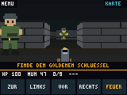

# Bunker 32

**[Firmware im Browser installieren](https://basti0772.github.io/bunker32/)** · [Installationsanleitung](#browser-installation)

Ein eigenständiger Retro-Ego-Shooter für den angeschlossenen ESP32 mit ILI9341 und resistivem Touch. Eigene Pixelgrafik, texturierte Wände, neun Wachen, Munition, Verbände, Karte und ein goldener Schlüssel. Finde den Schlüssel im nordöstlichen Raum und erreiche den grünen Ausgang im Südosten. Das Spiel läuft vollständig auf dem ESP32, auch ohne PC.



*Direkt aus dem Bildpuffer des ESP32 aufgenommen. Interne Auflösung: 160 × 120 Pixel; das Display zeigt das Bild mit zweifacher Skalierung.*

Weitere Ansichten: [Startbild](docs/screenshots/title.png) · [Spiel mit Karte](docs/screenshots/map.png).

## Browser Installation

Öffne **https://basti0772.github.io/bunker32/** in Chrome oder Edge auf einem Desktop-PC. Benötigt werden ein USB-Datenkabel und der passende Aufbau: **klassischer ESP32 / ESP32-WROOM / ESP32-D0WDQ6, mindestens 4 MB Flash, ILI9341 und Touch an den unten dokumentierten Pins**. ESP32-S2, S3 und C3 sind keine kompatiblen Varianten dieses Builds. ESP Web Tools prüft die Chipfamilie, aber nicht die Display-Verkabelung.

1. ESP32 per USB anschließen. PC-Steuerung und andere serielle Monitore schließen.
2. Auf **Install** klicken und den seriellen USB-Port auswählen.
3. Die Installation im Dialog starten und das Ende abwarten. Das USB-Kabel angeschlossen lassen.
4. Am Display antippen und die vier Kalibrierkreuze nacheinander halten. Danach spielen.

Die Browser-Installation ersetzt die bestehende Firmware und löscht gespeicherte Einstellungen einschließlich der Touch-Kalibrierung. Das zusammengeführte Image enthält auch die aufgefüllten Bereiche zwischen den Quell-Images. WLAN, ein Konto und die Arduino-IDE werden zum Spielen und Browser-Flashen nicht benötigt. Web Serial erfordert HTTPS; für lokale Tests ist `http://localhost` erlaubt. Fehlt der USB-Port, zunächst Kabel und USB-UART-Treiber prüfen; bei Verbindungsproblemen gegebenenfalls BOOT während des Verbindungsaufbaus halten.

### GitHub Pages einmalig aktivieren

Falls die Seite noch 404 anzeigt, im Repository **Settings → Pages → Build and deployment → Source: Deploy from a branch → Branch: main → Folder: /docs → Save** wählen. Anschließend die GitHub-Pages-Bereitstellung abwarten. Diese Repository-Einstellung lässt sich nicht allein durch eingecheckte Dateien einschalten. Die Dateien sind für genau diese Quelle vorbereitet; der CI-Workflow ändert keine Repository-Einstellungen.

`docs/manifest.json` referenziert `firmware/bunker32.bin`. Relativ zum Manifest ist dies die URL `https://basti0772.github.io/bunker32/firmware/bunker32.bin` und die Datei **`docs/firmware/bunker32.bin`**. Sie ist identisch mit dem gewünschten Repository-Artefakt **`firmware/bunker32.bin`**. Ein Verweis auf `../firmware/` würde bei einer `/docs`-Pages-Quelle das Projekt verlassen und ist deshalb bewusst ausgeschlossen. Die BIN wird dauerhaft mit dem Repository veröffentlicht; keine temporären Actions-Download-URLs.

### Web-Firmware selbst erzeugen

Die Build-Konfiguration steht in `tools/build-config.json`: FQBN `esp32:esp32:esp32`, Espressif Core 3.3.12, TFT_eSPI 2.5.43. Nach Installation von Arduino CLI die Abhängigkeiten einrichten:

```powershell
arduino-cli core update-index --additional-urls https://espressif.github.io/arduino-esp32/package_esp32_index.json
arduino-cli core install esp32:esp32@3.3.12 --additional-urls https://espressif.github.io/arduino-esp32/package_esp32_index.json
arduino-cli lib update-index
arduino-cli lib install TFT_eSPI@2.5.43
powershell -NoProfile -ExecutionPolicy Bypass -File .\tools\Build-Web-Firmware.ps1
powershell -NoProfile -ExecutionPolicy Bypass -File .\tools\Test-Web-Firmware.ps1 -WithBuild
```

Das Skript verwendet den vorhandenen Build-Helfer, kompiliert standardmäßig vollständig ohne Cache und liest anschließend **`build/flash_args` sowie die expandierten Arduino-Build-Eigenschaften**. Es findet das zur installierten ESP32-Plattform gehörende esptool automatisch. `merge-bin --format raw --target-offset 0 @flash_args` erzeugt eine Datei für die explizite Basisadresse **0x0000**, ohne unnötige Auffüllung bis zur vollen Flash-Größe. Alle Quelladressen stammen aus dem tatsächlichen Build, nicht aus fest codierten Beispielen. Es wird kein COM-Port geöffnet.

Der aktuell geprüfte Build verwendet **DIO, 80 MHz, 4 MB, Partitionierung `default`**:

| Build-Image | Adresse aus `flash_args` |
|---|---:|
| `Bunker32.ino.bootloader.bin` | `0x1000` |
| `Bunker32.ino.partitions.bin` | `0x8000` |
| `boot_app0.bin` | `0xe000` |
| `Bunker32.ino.bin` | `0x10000` |
| Zusammengeführte `bunker32.bin` | `0x0000` (explizite Merge-Basis) |

Die Quell-Images werden nach dem Merge an ihren Adressen byteweise verglichen. Größe, SHA-256, Version, Chipfamilie, Partitionierung, Quellstand und Pages-Pfade werden geprüft. Die veröffentlichten Nachweise liegen in `docs/firmware/build-info.json`, `flash_args` und `partitions.csv`. Die zentrale Version steht in **`firmware/Bunker32/Version.h`**; Manifest und Webseite übernehmen sie automatisch.

Nach Firmware-Änderungen das Skript erneut ausführen und beide BIN-Kopien, das Manifest sowie die Metadaten gemeinsam committen. Der Workflow `.github/workflows/web-firmware.yml` prüft bei Push auf `main` und bei Pull Requests zunächst, ob das veröffentlichte Image zum Quellstand gehört, und baut anschließend neu. Das erzeugte Paket wird zusätzlich als Actions-Artefakt angeboten. Ein solches Artefakt aktualisiert die veröffentlichte Pages-BIN nicht automatisch.

**Lokale Vorschau:** `python -m http.server 8000 --bind 127.0.0.1 --directory docs`, dann `http://localhost:8000/` öffnen. Die Seite lädt ESP Web Tools 10.1.1 von unpkg; dafür muss eine Internetverbindung bestehen.

**Fallback ohne Browser:** `powershell -ExecutionPolicy Bypass -File .\Build-And-Flash.ps1 -Port COM3` kompiliert und flasht wie bisher. `COM3` ist hier ein Beispiel: den eigenen Geräteport einsetzen. Ohne `-Port` lässt sich mit `-BuildOnly` weiterhin ausschließlich bauen. Dieser normale Upload schreibt die einzelnen Images und erhält dadurch die dazwischenliegende NVS-Partition.

Technische Grundlagen: [ESP Web Tools und Manifestformat](https://esphome.github.io/esp-web-tools/), [esptool merge-bin](https://docs.espressif.com/projects/esptool/en/latest/esp32/esptool/basic-commands.html#merge-binaries-for-flashing-merge-bin), [GitHub-Pages-Publikationsquelle](https://docs.github.com/en/pages/getting-started-with-github-pages/configuring-a-publishing-source-for-your-github-pages-site).

## Spielen

**Am Gerät:** Startbild antippen. Die fünf Tasten unten sind Zurück, Links drehen, Vorwärts, Rechts drehen und Feuer. Im 3D-Bild kann man oben/unten zum Gehen und links/rechts zum Drehen halten; die diagonalen Bereiche kombinieren beides. Auto-Feuer ist anfangs eingeschaltet: Ziele durch Drehen auf eine Wache. Oben links öffnet sich die Pause, oben rechts die Karte. In der Pause lässt sich links Auto-Feuer umschalten oder rechts Touch kalibrieren. Unten tippen setzt das Spiel fort.

**Am PC:** `Spielen.cmd` doppelklicken. Das Programm verbindet sich mit COM3; ein anderer Port ist im Fenster wählbar. Das Fenster muss für Tastatureingaben den Fokus haben. USB bleibt angeschlossen, eine WLAN-Einrichtung ist nicht nötig.

| Taste | Aktion |
|---|---|
| Enter | Start / weiter / nach Spielende neu |
| W / S oder ↑ / ↓ | Vor / zurück |
| A / D oder ← / → | Links / rechts drehen |
| Q / E | Seitwärts gehen |
| Leertaste | Feuern |
| F | Auto-Feuer umschalten |
| M | Karte |
| P / Esc | Pause / weiter |
| R | Neue Runde |

Die PC-Vorschau zeigt rund zwei Bilder pro Sekunde. Tastatureingaben werden alle 33 ms übertragen; die Anzeige direkt am ESP32 läuft unabhängig davon. Nach Fokusverlust werden Tasten freigegeben. Der ESP32 verwirft PC-Bewegung nach 250 ms ohne Aktualisierung. Nach USB-Trennung bleibt Touch nutzbar; die PC-App versucht die Verbindung erneut.

Eine vorhandene `chess-touch/rot3-v1`-Kalibrierung wird für die aktuelle Displaydrehung übernommen. Eine neue Vierpunkt-Kalibrierung wird separat in `bunker32/rot1-v1` gespeichert. Ohne gespeicherte Kalibrierung startet der erste Touch die Kalibrierung. PC-Steuerung funktioniert auch ohne Touch-Kalibrierung.

## Hardware

Ermittelt: ESP32-D0WDQ6, 240 MHz, 4 MB Flash, CP210x an COM3. ILI9341 im Querformat 320 × 240; intern 160 × 120 Pixel mit zweifacher Skalierung. Kein PSRAM nötig.

| Anschluss | GPIO |
|---|---:|
| SPI MISO / MOSI / SCLK | 19 / 23 / 18 |
| TFT CS / DC / RST | 15 / 2 / 4 |
| Touch CS | 32 |

## Bauen und flashen

Getestete Voraussetzungen: Arduino CLI, Espressif ESP32 Core 3.3.12, TFT_eSPI 2.5.43; für die PC-App Windows PowerShell 5.1 und .NET Framework. Die Build-Skripte sind für Windows ausgelegt. Die PC-EXE wird lokal aus dem mitgelieferten C#-Quellcode erstellt; `Spielen.cmd` erledigt das beim ersten Start automatisch.

```powershell
powershell -ExecutionPolicy Bypass -File .\Build-And-Flash.ps1 -BuildOnly
powershell -ExecutionPolicy Bypass -File .\Build-And-Flash.ps1 -Port COM3
powershell -ExecutionPolicy Bypass -File .\pc\Build-Controller.ps1
powershell -ExecutionPolicy Bypass -File .\tests\Test-Device.ps1
```

Das PC-Steuerfenster vor Flashen oder Gerätetests schließen, damit der COM-Port frei ist. `DisplayConfig.h` wird beim Build auch für TFT_eSPI eingebunden; die globale Bibliothekskonfiguration wird nicht verändert. Flashen ersetzt die bestehende Anwendung. Sicherungen liegen im ignorierten Ordner `backups`, Build-Dateien in `build`, PC-EXE und Testbilder in `artifacts`.

`powershell -ExecutionPolicy Bypass -File .\Restore-Previous.ps1` kann auf dem ursprünglichen Entwicklungs-PC den vorher gesicherten kompletten Flash wiederherstellen. Dafür werden die lokale Datei `backups/before-bunker32-safe.bin` und ihre `.sha256`-Prüfsumme benötigt. Diese gerätespezifische Sicherung ist nicht Bestandteil des Repositorys. Beim Wiederherstellen wird Bunker 32 auf dem Gerät ersetzt; die Projektdateien bleiben erhalten.

## Projektstruktur und geprüfter Stand

| Pfad | Inhalt |
|---|---|
| `firmware/Bunker32/` | ESP32-Sketch, Spiellogik, Renderer und Display-Konfiguration |
| `pc/` | C#-Quellcode und Build-Skript für das Windows-Steuerfenster |
| `Spielen.cmd` | PC-Steuerung bauen und starten |
| `Build-And-Flash.ps1` | Firmware kompilieren und aufspielen |
| `tests/` | Karten-/Grafikprüfung und Integrationstest auf dem ESP32 |
| `docs/screenshots/` | Originale, über USB gelesene Bilder vom ESP32 |
| `tools/` | Reproduzierbarer Web-Build, Metadatenprüfung und zentrale Board-Konfiguration |
| `docs/index.html` | GitHub-Pages-Installer mit ESP Web Tools |
| `firmware/bunker32.bin` | Zusammengeführte Firmware für Flash-Adresse 0 |
| `docs/firmware/` | Identische Pages-BIN sowie Herkunft, Hashes und Flash-Layout |

Die ursprüngliche Spielfirmware wurde auf den ESP32 geflasht und die geschriebenen Daten per Hash geprüft. Der damalige Gerätetest bestand: Spielmechanik-Selbsttest, Start, Bewegung über USB, Eingabe-Timeout, Kampf, Pause und Bildübertragung. Die vorhandene Touch-Kalibrierung wurde erfolgreich geladen; die physische Touch-Bedienung wurde nicht automatisch getestet. Im Gerätetest wurden bis zu 18 Bilder/s gemeldet. Das Web-Image mit Version 1.0.0 wurde vollständig neu gebaut und auf Layout, Inhalt und Manifest geprüft; der Installer wurde im Browser getestet. Ein erneuter USB-Flash-Test dieses Web-Images wurde nicht durchgeführt.

Die statische Prüfung kann ohne angeschlossenen ESP32 laufen:

```powershell
python .\tests\check_layout.py
```

## USB-Protokoll

921600 Baud, 8N1. ASCII-Zeilen mit LF. `K n` setzt die Eingabebits: vor=1, zurück=2, links=4, rechts=8, seitwärts links=16, seitwärts rechts=32, Feuer=64. Mehrere Bits können kombiniert werden. Mindestens alle 250 ms auffrischen; sonst stoppt die Bewegung.

Weitere Befehle: `START`, `NEW`, `MENU`, `PAUSE`, `AUTO`, `MAP`, `CAL`, `CANCEL`, `STATE`, `SELFTEST`, `SNAP`, `STREAM 1`, `STREAM 0`. Streaming braucht `K` als Heartbeat innerhalb von zwei Sekunden. Ein Bildpaket enthält `B32F`, 32-Bit-Little-Endian-Länge 38400, acht Metadatenbytes (HP, Munition bis 255, besiegte Wachen, Modus, FPS, Schlüssel, Auto-Feuer, Kalibrierung), dann 160 × 120 RGB565-Pixel, Little Endian. Modi: Titel=0, Spiel=1, Pause=2, Sieg=3, Tod=4.

Der Gerätetest prüft mit unabhängigen Spielzuständen unter anderem Karten-Erreichbarkeit, Kollision, Sichtlinien, Raycasting, Kampf und Siegbedingung; anschließend echte serielle Bewegung, Timeout, Kampf, Pause und Bildschirmübertragung. Er setzt die Spielrunde zurück.

Technische Referenzen: [TFT_eSPI](https://github.com/Bodmer/TFT_eSPI), [Espressif Flash-Werkzeuge](https://docs.espressif.com/projects/esptool/en/latest/esp32/esptool/basic-commands.html).
